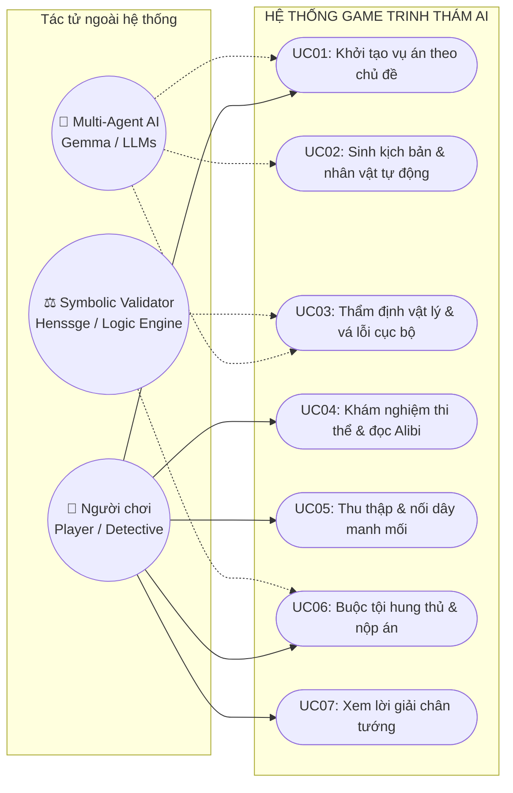
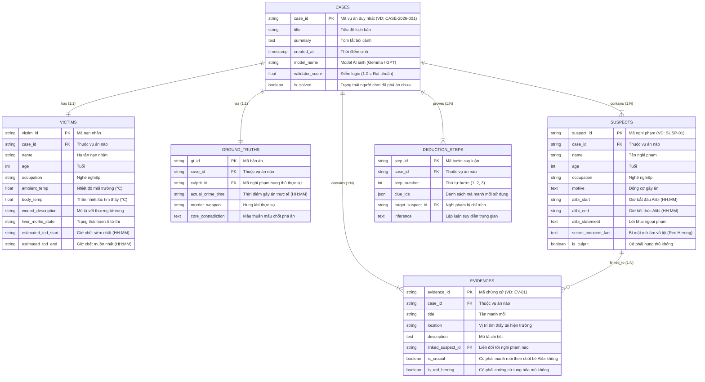

# THIẾT KẾ KIẾN TRÚC HỆ THỐNG: SƠ ĐỒ USE CASE & CƠ SỞ DỮ LIỆU (ERD)
**Đồ án Tốt nghiệp: Hệ thống Game Trinh thám Tạo sinh bằng AI Neuro-Symbolic**
*Sinh viên: Nguyễn Ngọc Công Anh | MSSV: 22010201 | Phenikaa University*

---

## PHẦN 1: SƠ ĐỒ USE CASE (USE CASE DIAGRAM)

### 1.1. Hình ảnh Sơ đồ Use Case
> 🖼️ **Ảnh xuất bản độ phân giải cao (300 DPI):**  
> [detective-backend/figures/so_do_usecase.png](file:///d:/Work/Đồ%20Án%20Tốt%20Nghiệp/detective-backend/figures/so_do_usecase.png)

### 1.2. Bảng Phân tích Chi tiết Các Ca Sử Dụng (Use Cases)

| Mã UC | Tên Use Case | Tác tử (Actors) | Mô tả chi tiết |
| :---: | :--- | :--- | :--- |
| **UC01** | Khởi tạo vụ án | Người chơi, AI | Người chơi chọn chủ đề mong muốn (VD: *Du thuyền sông Nile, Phòng máy chủ AI*) hoặc chọn sinh ngẫu nhiên. |
| **UC02** | Sinh kịch bản tự động | Multi-Agent AI | 4 Agent (`Outline`, `Character`, `Clue`, `Deduction`) tự động sinh bối cảnh, nạn nhân, 3 nghi phạm và 3-4 manh mối. |
| **UC03** | Thẩm định & Vá lỗi | Symbolic Validator, AI | Kiểm định công thức Henssge và đồ thị phá án. Nếu sai lệch, gửi phản hồi bắt đúng Agent liên quan vá cục bộ (Patch Repair). |
| **UC04** | Khám nghiệm hiện trường | Người chơi | Người chơi xem xét nhiệt độ phòng, thân nhiệt nạn nhân, vết thương và nghe lời khai Alibi của từng nghi phạm. |
| **UC05** | Nối dây manh mối (Corkboard) | Người chơi | Người chơi tương tác trên bảng điều tra, nối dây đỏ giữa lời khai nghi phạm và chứng cứ gián tiếp (dao, thẻ từ, ly trà). |
| **UC06** | Buộc tội hung thủ (Verify) | Người chơi, Validator | Người chơi chọn 1 nghi phạm là hung thủ + chọn chứng cứ mấu chốt để bẻ gãy Alibi. Hệ thống tự động chấm điểm. |
| **UC07** | Xem lời giải chân tướng | Người chơi | Khi phá án thành công (hoặc kết thúc lượt chơi), hệ thống mở khóa toàn bộ Bản án ngầm (Ground Truth) và chuỗi suy luận đa bước. |

---

## PHẦN 2: THIẾT KẾ CƠ SỞ DỮ LIỆU (DATABASE ERD SCHEMA)

### 2.1. Hình ảnh Sơ đồ Thực thể Liên kết (ERD)
> 🖼️ **Ảnh xuất bản độ phân giải cao (300 DPI):**  
> [detective-backend/figures/so_do_co_so_du_lieu_erd.png](file:///d:/Work/Đồ%20Án%20Tốt%20Nghiệp/detective-backend/figures/so_do_co_so_du_lieu_erd.png)

---

### 2.2. Chi tiết Các Bảng & Toàn Vẹn Dữ Liệu (Integrity Constraints)

1. **Bảng `CASES` (Bảng cha trung tâm):**
   - Đóng vai trò gốc để quản lý vòng đời của mọi vụ án.
   - Khi xóa 1 Case $\rightarrow$ Tự động xóa (Cascade Delete) toàn bộ Nạn nhân, Nghi phạm, Chứng cứ liên quan.
2. **Quan hệ 1:1 (`VICTIMS` và `GROUND_TRUTHS`):**
   - Mỗi vụ án bắt buộc có đúng 1 Nạn nhân và 1 Bản án bí mật.
   - `GROUND_TRUTHS.culprit_id` là khóa ngoại trỏ thẳng tới `SUSPECTS.suspect_id` đảm bảo hung thủ luôn tồn tại trong danh sách nghi phạm.
3. **Quan hệ 1:N (`SUSPECTS`, `EVIDENCES`, `DEDUCTION_STEPS`):**
   - Mỗi vụ án có từ $3 - 5$ nghi phạm và $3 - 6$ manh mối.
   - Ràng buộc toàn vẹn: Bắt buộc phải có **ít nhất 1 bản ghi `EVIDENCES` có `is_crucial = True`** để bảo đảm tính giải được.
4. **Cơ chế lưu trữ linh hoạt:**
   - Trong môi trường phát triển & kiểm thử: Dữ liệu được ánh xạ 1:1 sang JSON file trong thư mục `cases/{case_id}.json`.
   - Trong môi trường production: Schema trên sẵn sàng triển khai trên **PostgreSQL / SQLite** qua SQLAlchemy/SQLModel mà không cần thay đổi bất kỳ trường dữ liệu nào.
